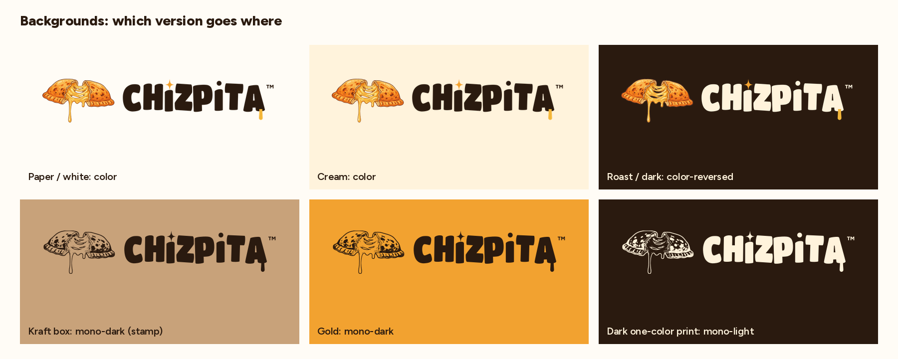
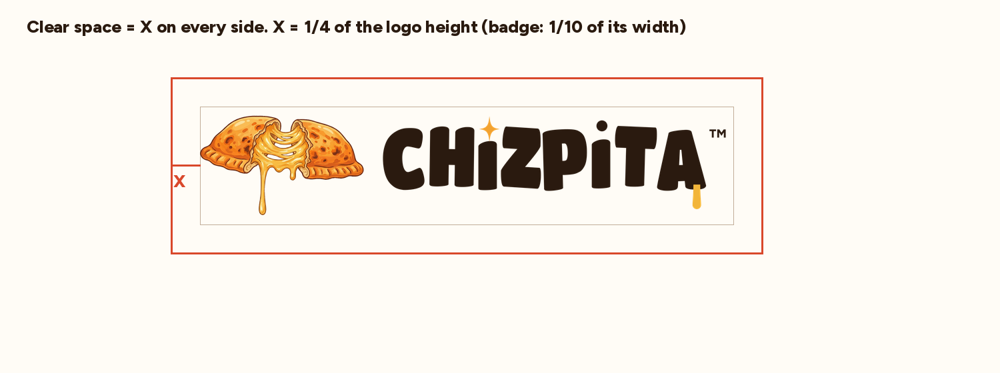
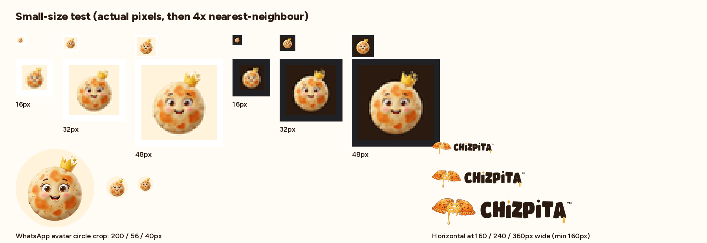
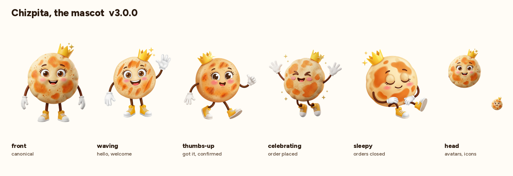
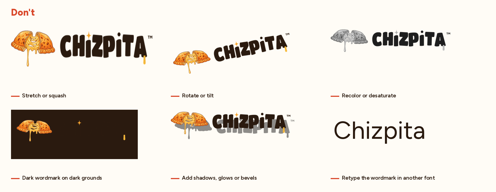

# Chizpita™ brand guide · v3.0.0

Chizpita (Cheesy Pockets LLC) makes handmade cheese-filled pita pockets in San Diego, baked to order and sold by the dozen. The brand looks like the product: toasted, golden, with a big cheese pull, and a friendly round mascot.

**The name.** Always **CHIZPITA** in logos, **Chizpita** in running text: one word, with a **C**. The mascot has the same name: the character is the brand.

**Trademark.** Use **™**, never ®. Every lockup that includes the wordmark already carries a small ™ at the top right. The mark, app icons, favicons and mascot art don't carry it. In text, write **Chizpita™** on the first or most prominent mention of a page, post, flyer or package, then plain *Chizpita*. Don't add a second ™ next to a lockup.

**Taglines** (English only): *Love at first bite* · *Handmade with love* · *Handmade in San Diego*. The badge uses the first two.

**Flavors:** Kalamata Olive, Zatar, Pizza, Chipotle, **El Clásico** (the plain cheese one; same name in every language) and Chilaquil Verde.


## 1. The system

The full-color pieces combine a painted illustration (the toasted pita with its cheese pull, and the mascot) with vector type, so the spelling and the ™ are always exact and the letters stay crisp. One-color pieces are fully vector.

| Piece | Master | Use it for | Minimum size |
|---|---|---|---|
| **Badge** (primary) | `logo/badge/chizpita-badge-color.png` | Website hero, flyers, stickers, packaging | 160 px · 50 mm print |
| **Horizontal** | `logo/horizontal/chizpita-horizontal-color.png` | Website and app headers, email | 160 px wide |
| **Stacked** | `logo/stacked/chizpita-stacked-color.png` | Box lids, bags, square spaces | 120 px wide |
| **Mark** | `logo/mark/chizpita-mark-color.png` | The pita alone, next to the name or as decoration | 64 px |
| **Wordmark** | `logo/wordmark/chizpita-wordmark-*.svg` | When the pita or the mascot is already nearby | 100 px wide |
| **App icon / avatar** | `logo/icon/chizpita-icon-*.png` | Favicons, home screen, WhatsApp and Instagram avatars | 16 px |
| **One color** | `logo/*/chizpita-*-mono-dark.svg`, `-mono-light.svg` | Rubber stamps, kraft boxes, embroidery, one-color print | badge 38 mm |

Small sizes use the **mascot's face** (the app icon), not the pita: a round face reads at 16 px, a wide illustration doesn't.

Machines and agents: don't guess. **`brand.json`** maps each use (favicon, WhatsApp avatar, link preview, kraft stamp…) to the exact file.

### Which version on which ground

| Variant | Ground |
|---|---|
| `color` | paper, cream, white, light photos. The badge brings its own cream disc, so it also works on dark or chalkboard grounds. |
| `color-reversed` | roast brown, black, dark photos (cream wordmark) |
| `mono-dark` | kraft, gold, any one-color print, stamps, embroidery on light fabric |
| `mono-light` | dark one-color print, embroidery on dark fabric |



## 2. Clear space and sizes

Keep clear space of **X on every side, where X is ¼ of the logo's height** (for the badge, 1/10 of its width). Nothing else sits inside it.





## 3. Color

| Token | HEX | RGB | CMYK (approx.) | Role |
|---|---|---|---|---|
| `roast` | `#2A1A0F` | 42 26 15 | 0 38 64 84 | Ink: wordmark, outlines, body text |
| `spark-gold` | `#F2A230` | 242 162 48 | 0 33 80 5 | The spark on the i, rays, heart, accents |
| `cheese` | `#F2B53A` | 242 181 58 | 0 25 76 5 | The drip off the A, warm highlights |
| `crust` | `#E3913A` | 227 145 58 | 0 36 74 11 | Toasted crust orange (matches the art) |
| `cream` | `#FFF3DC` | 255 243 220 | 0 5 14 0 | Badge and icon ground |
| `paper` | `#FFFCF6` | 255 252 246 | 0 1 4 0 | Page background |
| `olive` | `#4E6B2C` | 78 107 44 | 27 0 59 58 | Green flavors (Chilaquil Verde) |

CMYK values are naive conversions for briefing a printer; proof on the real stock. **Contrast:** roast on paper/cream is 15–16:1 (any text). Gold and crust are for art and accents only, never for text on light grounds (about 2.3–2.5:1). Gold text on roast is fine (8:1).

Tokens: `tokens/tokens.json` (W3C design-token format, with RGB/CMYK/contrast) and `tokens/brand.css` (`--chz-*` variables).

## 4. Type

- **Titan One** (display, OFL): headlines, prices, short shouts. The wordmark is built from it but is custom (taller letters, dotless *i*s, the gold spark, the round dot, the cheese drip off the A) and is always used as artwork, **never retyped**.
- **Figtree** (text, OFL): everything else, including UI, menus and order pages. Weights 400 to 800.

Both are on Google Fonts; `tokens/brand.css` imports them. Font files and licenses: `tools/fonts/`.

## 5. Chizpita, the mascot

A round, puffy, griddle-toasted pita with big lashed eyes, rosy cheeks, a happy open smile, a little gold crown with a sparkle, white cartoon gloves and yellow sneakers.



| File | When |
|---|---|
| `mascot/chizpita-mascot-front.png` | Canonical. About pages, packaging, general use |
| `mascot/chizpita-mascot-waving.png` | Hello / welcome, first message, landing |
| `mascot/chizpita-mascot-thumbs-up.png` | "Got it", small confirmations |
| `mascot/chizpita-mascot-celebrating.png` | Order placed (the order-page confirm moment) |
| `mascot/chizpita-mascot-sleepy.png` | Orders closed (after Wednesday 1:00 PM), sold out |
| `mascot/chizpita-mascot-head.png` | Avatars, reactions, icons |

Rules: the mascot never replaces the logo on packaging; keep it upright and in its own colors. New poses are generated from the same character description (`art/README.md`) and checked against these five before they're added.

## 6. Don'ts



Also don't: crop the cheese drip, put the color horizontal lockup on busy photos (use the badge), or create new logo variations with an image generator. The files in this repo are the only source.

## 7. Files and naming

```
art/source/                        canonical illustrations as generated (see art/README.md)
logo/<piece>/chizpita-<piece>-<variant>.png|svg   masters (PNG full color, SVG vector)
mascot/chizpita-mascot-<pose>.png  mascot masters (transparent)
social/chizpita-og-image.png       link-preview master
exports/                           GENERATED; never edit by hand
  logo/<piece>/<name>-<width>.png, -<width>@2x.png
  mascot/<name>-<width>.png, @2x
  web/     favicon.ico, favicon-16/32/48, apple-touch-icon, icon-192/512, maskable, site.webmanifest
  social/  avatar-640 (WhatsApp, Instagram), avatar-badge-640, avatar-dark-640, og-image-1200x630
tokens/    tokens.json, brand.css
tools/     build, cutout, trace, export and check scripts; fonts
docs/      the reference sheets in this guide
brand.json use-case to file manifest
```

`make` rebuilds everything from `art/source/` and `tools/`: cutouts, the one-color trace, all masters, exports, tokens, docs, then `make check`.

## 8. Versioning

Semantic versions, tagged in git (current `v3.0.0`):
- **patch** (3.0.x): export fixes or new export sizes, same artwork
- **minor** (3.x.0): new poses, lockups or variants; existing files unchanged
- **major** (x.0.0): any change to existing artwork or file names

Link to a tag (`brand.json` `base_urls`), not to `main`, so a redesign never silently changes live sites. See `CHANGELOG.md`.
