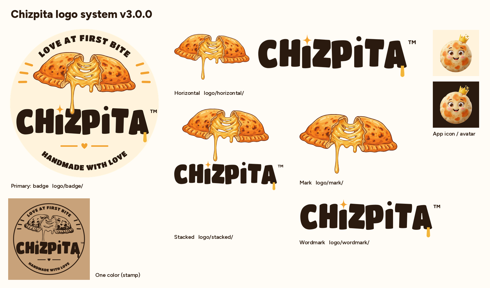

# Chizpita™ brand assets

Canonical logo system, mascot (named Chizpita, like the brand), color and type tokens for **Chizpita** (Cheesy Pockets LLC, San Diego).

- **Which file do I use?** See [`brand.json`](brand.json) (machine-readable) or [`BRAND.md`](BRAND.md) (rules and examples).
- **Masters:** `logo/`, `mascot/`, `social/`. **Exports:** `exports/` (generated). **Illustration sources:** `art/source/`.
- **Rebuild:** `pip install -r tools/requirements.txt && brew install librsvg potrace && make`
- **Link to a version tag**, e.g. `https://cdn.jsdelivr.net/gh/chizpita/brand@v3.0.0/logo/badge/chizpita-badge-color.png`

Current version: **v3.0.0**. See [CHANGELOG.md](CHANGELOG.md).
